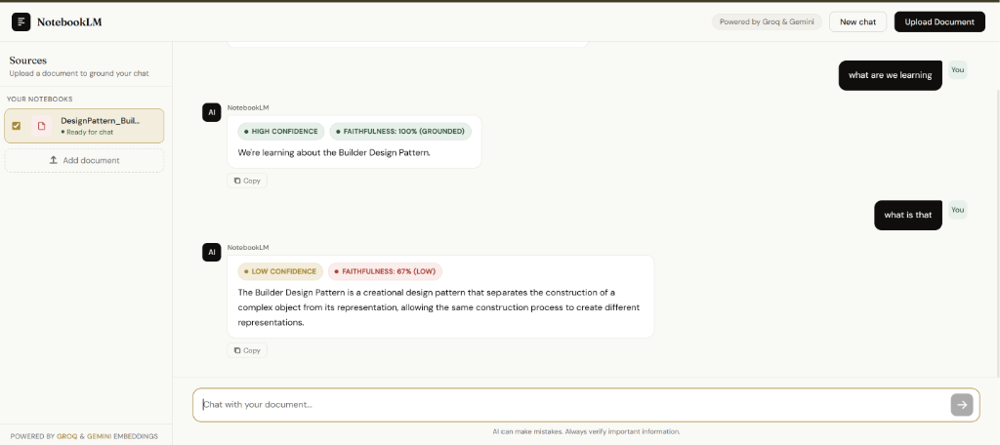

<div align="center">
  <h1 align="center">AskMyDoc 2.0: RAG over your PDF and text files</h1>
  <p align="center">
    <strong>A FastAPI app that answers questions from uploaded documents using LangChain, ChromaDB, all-MiniLM-L6-v2 embeddings, and Ollama (local) or Groq (hosted) as the LLM.</strong>
  </p>

  <br />
  
</div>

---

## Overview
AskMyDoc 2.0 parses PDF/TXT files into parent and child chunks, embeds the child chunks with Hugging Face `sentence-transformers/all-MiniLM-L6-v2`, and stores them in ChromaDB (one collection per document). A question retrieves the top matching chunks and passes their parent chunks to an LLM that is told to answer only from that context.

- **LLM:** Ollama (default `llama3.1:8b-instruct-q4_K_M`, set with `OLLAMA_MODEL`). Groq is used when `LLM_PROVIDER=groq`, and as the fallback when Ollama fails and `GROQ_API_KEY` is set. The Groq model is `GROQ_MODEL` (default `openai/gpt-oss-20b`). When a Groq key is set, any Ollama error at request time (server unreachable, model missing) re-runs the request on Groq. Timeouts: `OLLAMA_CONNECT_TIMEOUT` (seconds, default 3) and `OLLAMA_READ_TIMEOUT` (seconds, default none).
- **Embeddings:** all-MiniLM-L6-v2 on the local machine by default. Set `EMBEDDING_BACKEND=hf_api` (and `HF_TOKEN`) to use the Hugging Face Inference API instead; it is never selected implicitly, and there is no automatic fallback between the two. `EMBEDDING_MODEL` overrides the model id or path.
- **Parent/child chunking:** 3000-char parents (300 overlap), 400-char children (100 overlap) (`app/ingest.py`).
- **Faithfulness check:** `POST /api/evaluate` asks the LLM to list the claims in an answer and mark each as supported or not by the context. The score is computed in code as supported claims / total claims from the judge's per-claim verdicts. It is a model judgement, not a guarantee. The request carries the `chunkIds` from the `/api/chat` response, and the server reads the context text from the store; a `context` field sent by a client is ignored, and a body without `chunkIds` is rejected (clients that still send `context` get 422). Documents ingested before this change have no chunk ids and must be re-uploaded before the judge can score their answers. If the judge fails or returns no usable verdicts, the score is `null` and the UI shows "unavailable".
- **`/api/metrics`:** request counts, average LLM and retrieval latency, queue depth, an approximate tokens/sec (word count x 1.3 over LLM time), and memory of the app process only: `torch.cuda.memory_allocated` if CUDA is available, otherwise process RSS (not Ollama's memory). `provider` and `model_name` show what served the last request (Ollama or the Groq fallback); `quantization` is `unknown` unless the Ollama tag ends in a quant suffix such as `q4_K_M`.
- **Scanned PDFs:** if PyPDF (30 characters or fewer) and then pdfplumber extract no text, the file is sent to the third-party OCR.space API.
- **Docker Compose:** `docker-compose.yml` runs Ollama and the FastAPI app. It reserves an NVIDIA GPU for Ollama, so it fails to start without the NVIDIA container runtime (see Quick Start for alternatives).

Pinecone was used in v1 (the Node.js version). v2 has no Pinecone code.

---

## Stack
- Python 3.11, FastAPI, Uvicorn
- LangChain, ChromaDB (local persistent)
- Hugging Face `sentence-transformers/all-MiniLM-L6-v2` embeddings
- Ollama (local LLM), Groq (hosted LLM / fallback)
- Docker and Docker Compose

---

## API Endpoints Reference

| Endpoint | Method | Description |
|---|---|---|
| `GET /api/health` | `GET` | Returns `status` plus the configured LLM provider and vector store type. Config only; it does not contact Ollama or Groq |
| `GET /api/metrics` | `GET` | Live infrastructure metrics (approximate token throughput, app-process memory (CUDA allocation or process RSS, not Ollama's VRAM), latencies, queue depth) |
| `POST /api/upload` | `POST` | Ingest PDF/TXT document, apply parent-child chunking, and persist in ChromaDB |
| `POST /api/chat` | `POST` | Execute grounded vector search and return LLM response with confidence badge, the sources, and `chunkIds` (the chunks whose text was sent to the LLM) |
| `POST /api/evaluate` | `POST` | LLM-as-a-judge faithfulness score. Body: `{query, answer, chunkIds, namespaces}`; the server reads the context from the store |
| `POST /api/delete` | `POST` | Delete vector collection/namespace from ChromaDB |

---

## Quick Start with Docker Compose (Recommended)

1. Clone the repository:
   ```bash
   git clone https://github.com/swarnika-cmd/AskMyDoc-2.O.git
   cd AskMyDoc-2.O
   ```
2. Start the stack, then pull the Ollama model into the Ollama container:
   ```bash
   docker compose up -d --build
   docker compose exec ollama ollama pull llama3.1:8b-instruct-q4_K_M
   ```
   The compose file reserves an NVIDIA GPU for Ollama (`deploy.resources` block), so it fails without the NVIDIA container runtime. To run without a GPU, remove that block from the `ollama` service. Alternatively run Ollama on the host and set `LLM_BASE_URL` for the app service (for example `http://host.docker.internal:11434`) and drop the `ollama` service.
4. Access the web interface at `http://localhost:8000` or inspect live metrics at `http://localhost:8000/api/metrics`.

---

## Manual Local Setup

### 1. Installation & Environment
```bash
python -m venv venv
# Windows:
venv\Scripts\activate
# Linux/macOS:
source venv/bin/activate

pip install -r requirements.txt
cp .env.example .env
```

### 2. Configure Environment (`.env`)
```env
LLM_PROVIDER=ollama   # or groq
LLM_BASE_URL=http://localhost:11434
OLLAMA_MODEL=llama3.1:8b-instruct-q4_K_M
# GROQ_API_KEY=...        # needed for LLM_PROVIDER=groq or the Groq fallback
# GROQ_MODEL=openai/gpt-oss-20b
EMBEDDING_BATCH_SIZE=32
VECTOR_STORE_TYPE=chromadb
CHROMA_DB_PATH=./chroma_db
```

### 3. Run FastAPI Backend
```bash
uvicorn app.main:app --host 127.0.0.1 --port 8000 --reload
```

---

## Deployment
The app deploys with Docker (`Dockerfile`, `docker-compose.yml`). There is no Vercel config: the dependencies (sentence-transformers with torch, ChromaDB on local disk) do not fit Vercel's Python runtime limits.

`scripts/benchmark.py` measures latency against a running server. No benchmark results are published here.

---

## Testing
To run the automated backend test suite:
```bash
python tests/test_backend.py
```
`tests/test_backend.py` and `tests/test_fastapi_client.py` (in-process `TestClient`, no server needed; `test_backend.py` calls a server on port 8000), and both need an LLM backend for chat; `tests/quick_unit_test.py` runs ingestion only.

---

## Evaluation

`eval/` holds a harness that compares four retrieval pipelines on one corpus and one golden set. Everything below comes from scripts in this repository; the raw per-item outputs are in `eval/results/raw/`.

**Corpus.** Eight public Indian government and university PDFs, 413 pages (three SEBI documents, a DEA fiscal review, a Department of Expenditure pay report, an Economic Survey chapter that is a scan, and two university regulations). The PDFs are not committed; `eval/corpus.json` has the source URLs and SHA-256 hashes, `eval/fetch_corpus.py` downloads them, and the extracted page text (`eval/corpus/pages.jsonl`, 112 OCR pages) is committed. No explicit licence was found for these documents; the text is kept for evaluation only. See `eval/README_DATA.md`.

**Golden set.** 150 questions: 70 factual, 30 multi-hop, 30 table, 20 unanswerable. Questions were written from the source documents, and every answer is backed by a verbatim quote that `eval/validate_golden.py` checks against the page text (CI runs it). Single-pass construction (not double-annotated). These 20 ids are listed for re-checking by hand: q003 q004 q005 q008 q013 q014 q017 q025 q029 q034 q046 q077 q078 q079 q094 q101 q118 q128 q132 q142.

**Pipelines.** All use `sentence-transformers/all-MiniLM-L6-v2` and an in-memory ChromaDB collection. Parent and child sizes are imported from `app/ingest.py`.

| | Pipeline | Unit returned to the LLM |
|---|---|---|
| P1 | fixed 800-character chunks (100 overlap) + dense | the chunk |
| P2 | parent-child + dense (the current app design) | top-5 children, mapped to deduplicated parents |
| P3 | parent-child + BM25 + dense, fused with RRF (k=60) | top-5 fused children, mapped to parents |
| P4 | P3 + cross-encoder rerank (`BAAI/bge-reranker-base`, top-20 candidates) | top-5 reranked children, mapped to parents |

**Retrieval results** (`eval/results/retrieval_full.json` and `.md`; 130 answerable items; run on 2026-11-13). recall@5 counts an item as a hit when its supporting quote, whitespace-normalised, appears in one of the top-5 returned units. Parents (up to 3,000 characters) are larger than P1's 800-character chunks, which favours them, so the mean context size is shown.

| Pipeline | recall@5 | MRR@5 | mean context chars | latency p50 (ms) | latency p95 (ms) |
|---|---|---|---|---|---|
| P1 | 0.6308 | 0.4710 | 3220.0 | 5.8 | 7.6 |
| P2 | 0.8000 | 0.6163 | 7176.8 | 5.6 | 6.7 |
| P3 | 0.8692 | 0.7044 | 6895.1 | 11.6 | 14.8 |
| P4 | 0.8692 | 0.7150 | 6679.7 | 1223.2 | 1590.3 |

Latency measured 2026-11-13 03:13 UTC on an Apple M4 Pro host with no other benchmark running; container limited to 4 CPUs (torch threads 4). It covers one retrieval call (query embedding, search, fusion, rerank, parent mapping) and excludes index building. The quality columns are deterministic. With 130 items one item is 0.77 points, so the P3 and P4 recall tie and small gaps between pipelines are not claims.

Over the shipped design (P2), hybrid BM25+dense with RRF (P3) raised recall@5 from 0.8000 to 0.8692 and MRR@5 from 0.6163 to 0.7044 for +5.9 ms p50 retrieval latency; the cross-encoder (P4) added no recall@5 and about 1.2 s per query on CPU.

**LLM-judged results.** The generation and judging run (generator `openai/gpt-oss-20b`, judge `openai/gpt-oss-120b`, `reasoning_effort` low, temperature 0) is in progress. Groq's free tier allows 200,000 tokens per day per model, so the full run takes several days; results will appear in `eval/results/llm_*.md`. No LLM-judged numbers are published until it finishes. Responses are cached under `eval/cache/`, so reruns and resumes cost nothing.

**Running it.** Install `requirements-eval.txt`, then `make validate`, `make test`, `make eval-retrieval`, `make eval-ci` (CI subset plus regression check) and, with `GROQ_API_KEY` set, `make eval-llm PIPELINE=P2 IDS=all`.

**Limitations and disclosures.**
- 150 items over 8 documents, single-pass construction: confidence intervals are wide. The table reports n and makes no claim about small differences.
- recall@5 by quote containment misses paraphrased support and favours larger units. Multi-hop items are scored on the primary quote only; `retrieval_full.md` adds a retrieval-only "all refs retrieved@5" metric over the primary and extra quotes (P1 0.3667, P2 0.5333, P3 0.4667, P4 0.5333 on 30 items).
- P1 cannot exceed a recall of 0.9846: the quotes of q040 and q132 straddle 800/100 chunk boundaries (measured in `retrieval_full.json`, `ceiling`). P2 to P4 have a ceiling of 1.0000.
- An LLM judge has its own bias. The judge sees the reference answer and the item's answerability label, which can make it more lenient or more strict than a blind reader. It never sees which pipeline produced the context.
- The app's score gate (answers with a best child similarity below 0.2 are shown as NOT_FOUND regardless of the model) is not modelled. `eval/results/checks.md` shows the gate would not fire on this set: the best child cosine similarity is at least 0.5111 for all 150 questions, none is below 0.4. Refusal behaviour is therefore the model's own, following the app's prompt rule; refusal is read from the generator's no-evidence flag, with the judge as a cross-check.
- Vector search uses HNSW settings chosen for reproducible results (one build thread, M=32, ef 400). For P2 on the 130 answerable questions, exact search, these settings and Chroma's defaults returned identical top-5 child sets (`eval/results/checks.md`).
- The harness caps generator output at 1024 tokens and judge output at 2048; the app sets no cap. Every call of the 20-question pilot finished with `stop`; `llm_*.md` reports the number of non-`stop` finishes for the full run. The app and the harness both send `reasoning_effort` low to gpt-oss models on Groq.
- The served model name is stored with each call but is not part of the cache key.
- The judge prompt wording was adjusted once after the pilot; the 20 pilot judge responses were discarded and re-run.
- The CI regression check fails when a pipeline's recall@5 on the CI subset drops more than 3 points below `eval/results/baseline_ci.json`. The subset has 26 answerable items, so one item is 3.85 points and any single-item loss fails the check.
